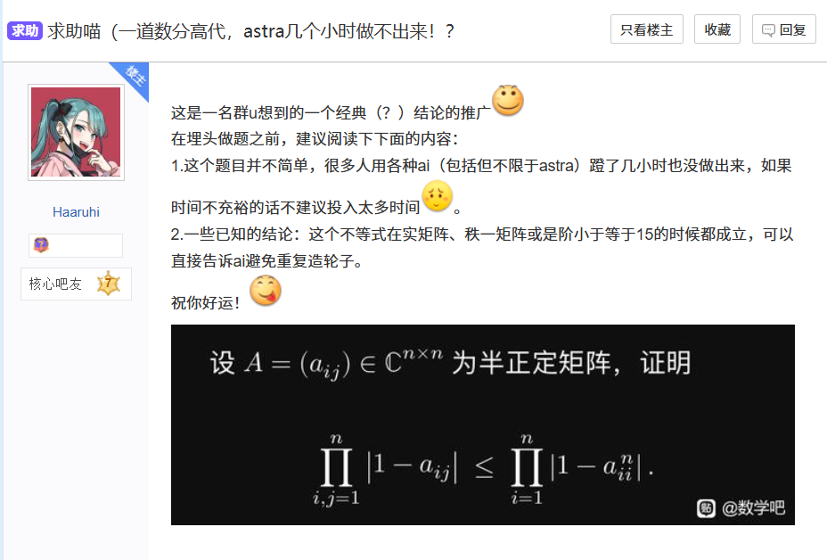

# An entrywise product inequality for positive semidefinite matrices

A Lean 4 proof of the following statement.

> **Theorem.** Let $A=(a_{ij})\in\mathbb C^{n\times n}$ be positive semidefinite. Then
> $$\prod_{i,j=1}^{n}\lvert 1-a_{ij}\rvert\ \le\ \prod_{i=1}^{n}\lvert 1-a_{ii}^{\,n}\rvert .$$

```lean
-- Statement.lean
def Statement.MainTheorem : Prop :=
  ∀ (n : ℕ) (A : Matrix (Fin n) (Fin n) ℂ), A.PosSemidef →
    ∏ i, ∏ j, ‖1 - A i j‖ ≤ ∏ i, ‖1 - A i i ^ n‖

-- MatrixIneq/Main.lean
theorem MatrixIneq.mainTheorem : Statement.MainTheorem
```

## The question

The statement comes from a post on Baidu Tieba (数学吧) by user Haaruhi. According to the post, the
inequality generalizes a classical result, was known for real matrices, for rank-one matrices and for
$n\le 15$, and had resisted many attempts with AI tools.



> 这是一名群u想到的一个经典（？）结论的推广
>
> 在埋头做题之前，建议阅读下下面的内容：
>
> 1. 这个题目并不简单，很多人用各种ai（包括但不限于astra）蹬了几小时也没做出来，如果时间不充裕的话不建议投入太多时间。
> 2. 一些已知的结论：这个不等式在实矩阵、秩一矩阵或是阶小于等于15的时候都成立，可以直接告诉ai避免重复造轮子。
>
> 祝你好运！
>
> 设 $A=(a_{ij})\in\mathbb C^{n\times n}$ 为半正定矩阵，证明
> $\prod_{i,j=1}^{n}|1-a_{ij}|\le\prod_{i=1}^{n}|1-a_{ii}^n|$.

The inequality is sharp: for $a_{ij}=d\,\omega^{\,i-j}$ with $\omega=e^{2\pi i/n}$ both sides equal
$\lvert 1-d^{\,n}\rvert^{\,n}$. For correlation matrices it reads $\prod_{i\ne j}\lvert 1-a_{ij}\rvert\le n^n$,
which for rank one is a classical inequality of Schur. A translation of the post and a comparison of the
Lean statement with the text are in [`docs/PROBLEM.md`](docs/PROBLEM.md).

## What we tried

**The framework.** Since $|1-d^n|=|1-d|(1+d+\dots+d^{n-1})$, only the off-diagonal product has to be
bounded. Write $a_{ij}=\sqrt{a_{ii}a_{jj}}\,c_{ij}$. We look for a lower bound of $-\log|1-a_{ij}|$ by a
harmonic polynomial in $c_{ij}$ whose coefficients are positive semidefinite kernels in the two diagonal
values. Summing over $i\ne j$, the Schur product theorem removes the cross terms. This is a
linear-programming certificate of Delsarte type, with coefficients that depend on the radius.

**Equal diagonal.** When all diagonal entries are equal, the right coefficients are those of the cosine
polynomial that interpolates $-\log|1-e^{-p}e^{i\theta}|$ to second order at the nontrivial $n$-th roots of
unity. They are tail integrals $\Gamma_m(p)=\int_p^\infty k_m$ of explicit kernels, and the interpolation
error is a Fejér kernel times an integral of Poisson kernels, hence nonnegative. This proves the theorem
for constant diagonal and every $n$.

**Unequal diagonal: where it got stuck.** The natural positive semidefinite extension off the diagonal is
the geometric mean $\sqrt{\Gamma_m(p)\Gamma_m(q)}$. It reduces the theorem to a single two-radius inequality.
That inequality is numerically true, but we could not prove it. The classical convexity criterion for
cosine sums settles it exactly up to $n=15$ and fails from $n=16$, which matches the range the post reports
as known. We reduced it twice more, the second time to a statement with no angle variable (convexity of an
explicit sequence), and formalized both reductions, but the remaining statement turned out to depend on
fine properties of hazard rates and stayed open.

**How it was finally proved.** Looking at that last reduction probabilistically, $\chi_m(w)=e^{mw}k_m(w)$ is
a distribution function, and $m\,\Gamma_m(p)=\mathbb E\,e^{-m\max(p,\tau)}$ for a random level $\tau$ with
that distribution. This suggests a different off-diagonal kernel,
$$K_m(p,q)=\frac1m\,\mathbb E\,e^{-m(\max(p,\tau)+\max(q,\tau))/2},$$
which is positive semidefinite by construction and has the right diagonal. For this kernel the two-radius
inequality needs no new estimate: it follows from the equal-diagonal inequality by Poisson smoothing and
integration along a path, and the constant term comes out exactly right. The geometric mean is not needed.

The full account is in [`docs/PROOF.md`](docs/PROOF.md).

## Lean proof state

The theorem is proved in full generality: every $n$, every complex positive semidefinite $A$, no
restriction on rank or on the size of the diagonal entries.

- `lake build` succeeds, and the proof library `MatrixIneq/` contains no `sorry`.
- `#print axioms MatrixIneq.mainTheorem` gives `[propext, Classical.choice, Quot.sound]`.
- Independent re-checking of the compiled proof: `leanchecker` replays every project module, and `nanoda`
  accepts a `lean4export` dump of `mainTheorem` with its 60,929 dependencies, permitting only those three
  axioms.
- `lake comparator --paranoid` accepts the solution (`Comparator/Solution.lean` against the challenge
  `Comparator/Challenge.lean`, configuration `comparator.json`): same statement, no axiom outside the three
  above, and the proof is accepted by every checker bundled with Lean: the default kernel, the paranoid
  kernel, `lean4lean`, `nanoda`, `con-leche` and `con-ron`.
- `Exploration/` holds the formalized results from the routes above that the final proof does not use
  (the cases $n\le 3$, the constant-diagonal theorem, and the reductions for the geometric-mean kernel,
  whose final hypothesis is unproved). `MatrixIneq/` does not import it.

Toolchain: Lean `v4.36.0`, Mathlib `v4.36.0`. To reproduce, run `lake exe cache get` once and then
`scripts/verify.sh`, which builds, checks the statement and axioms, and runs each checker that is installed.

## Credits

This proof is mainly done by Claude Fable 5.2 high with around 130usd API cost (stat from claude code).
